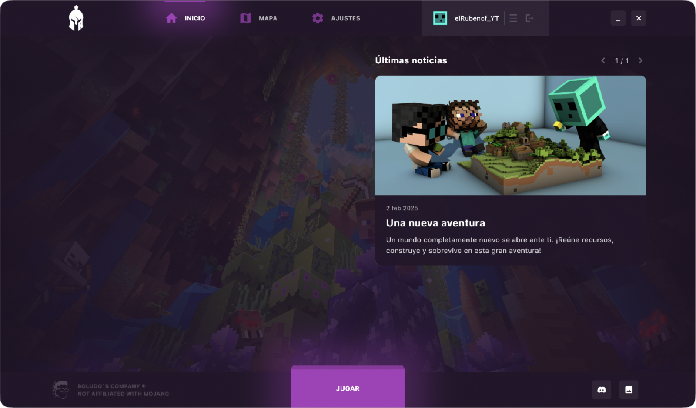
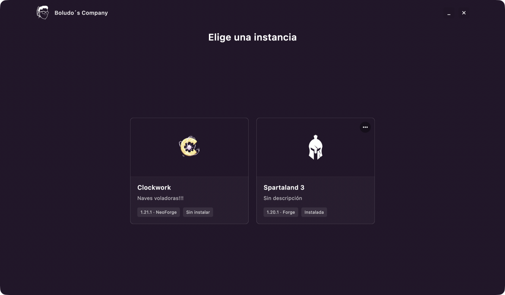

<p align="center">
  
</p>

<h1 align="center">BC Launcher</h1>

<p align="center">
  Un launcher de Minecraft para series y eventos.<br>
  Añade una organización, elige una instancia y juega: los mods, la configuración y Java corren de su cuenta.
</p>

<p align="center">
  <a href="https://github.com/elRubenof/bc-launcher/releases/latest"></a>
  <a href="https://github.com/elRubenof/bc-launcher/actions/workflows/ci.yml"></a>
  <a href="LICENSE"></a>
</p>

<p align="center">
  <a href="README.md">English</a> · Español
</p>

<p align="center">
  
  
</p>

## Qué hace

- **Organizaciones con un enlace.** Una organización (quienes están detrás de una serie o un evento) te da un enlace; ábrelo y el launcher la añade después de preguntarte.
- **Instancias siempre al día.** Cada instancia descarga sus mods, resource packs y configuración de la organización, y repara lo que se haya cambiado o falte antes de jugar.
- **Todos los loaders.** Vanilla, Fabric, Quilt, Forge (1.7.10+) y NeoForge (1.20.2+). El launcher instala Minecraft, el loader y la versión de Java que haga falta.
- **Noticias y enlaces.** Cada instancia muestra sus noticias, sus pestañas web y sus enlaces de Discord o web.
- **Sin conexión.** Una instancia instalada se abre aunque la organización o tu conexión no respondan.

## Descarga

| Sistema | Fichero | Requisitos |
|---|---|---|
| Windows | [BC-Launcher-Installer.exe](https://github.com/elRubenof/bc-launcher/releases/latest/download/BC-Launcher-Installer.exe) | Windows 10 u 11 de 64 bits |
| macOS | [BC-Launcher.dmg](https://github.com/elRubenof/bc-launcher/releases/latest/download/BC-Launcher.dmg) | macOS 12 o posterior, Intel o Apple silicon |
| Linux | [BC-Launcher.AppImage](https://github.com/elRubenof/bc-launcher/releases/latest/download/BC-Launcher.AppImage) | x86_64 |

No hace falta tener Java instalado. Las versiones anteriores y las notas de cada versión están en [Releases](https://github.com/elRubenof/bc-launcher/releases).

## Instalación

BC Launcher es gratuito y de código abierto, pero no tiene firma de pago, así que tu sistema no lo reconoce y avisa la primera vez. Estos pasos te lo explican.

### Windows

1. Abre `BC-Launcher-Installer.exe`.
2. Si aparece **Windows protegió su PC**, pulsa **Más información**.
3. Pulsa **Ejecutar de todas formas** y sigue el instalador.

Se instala solo para tu usuario, sin permisos de administrador.

### macOS

1. Abre `BC-Launcher.dmg` y arrastra **BC Launcher** a **Aplicaciones**.
2. Ábrelo desde Aplicaciones. Si macOS dice que no puede verificar que no tiene software malicioso, pulsa **OK**.
3. Ve a **Ajustes del Sistema › Privacidad y seguridad**, baja hasta el final y pulsa **Abrir igualmente**. Confirma con tu contraseña.

### Linux

1. Haz clic derecho en `BC-Launcher.AppImage` › **Propiedades** y marca **Permitir ejecutar como programa**, o ejecuta `chmod +x BC-Launcher.AppImage`.
2. Ábrelo con doble clic. La primera vez se añade al menú de aplicaciones.

Si no arranca, instala el paquete de FUSE de tu distribución (`fuse3` en la mayoría).

## Actualizaciones

El launcher busca una versión nueva al abrirse y cada pocas horas.

- **Windows:** descarga la actualización solo y te pide reiniciar. Nunca reinicia mientras juegas.
- **macOS y Linux:** te avisa y **Descargar** abre la versión nueva. Instálala encima de la anterior, como arriba; tus instancias, mundos y cuenta se mantienen.

## Añadir una organización

Abre la página de tu organización y pulsa **Abrir en BC Launcher**. El launcher te pregunta si quieres añadirla y después inicia sesión en ella. No hay ningún campo para escribir una dirección: las organizaciones solo se añaden con su enlace.

Con dos o más organizaciones, una columna a la izquierda te deja cambiar entre ellas.

## Para organizaciones

Para tener tu propia organización (instancias, contenido, noticias, acceso de jugadores), despliega [BC Launcher Server](https://github.com/elRubenof/bc-launcher-server). Su página pública da a tus jugadores las descargas y el enlace que añade tu organización.

## Compilar desde el código

Necesitas [Flutter](https://flutter.dev) 3.47 o posterior (canal stable).

1. Copia `.env.example` a `.env` y pon en `MS_CLIENT_ID` el client ID de tu app de Azure (`MS_REDIRECT_URL` es opcional).
2. Ejecútalo:

```bash
flutter pub get
flutter run -d windows --dart-define-from-file=.env
```

Usa `-d macos` o `-d linux` en esos sistemas. `flutter test` ejecuta los tests. [AGENTS.md](AGENTS.md) explica la estructura del proyecto, los instaladores y cómo se publican las versiones.

## Licencia

[GPL-3.0](LICENSE)
