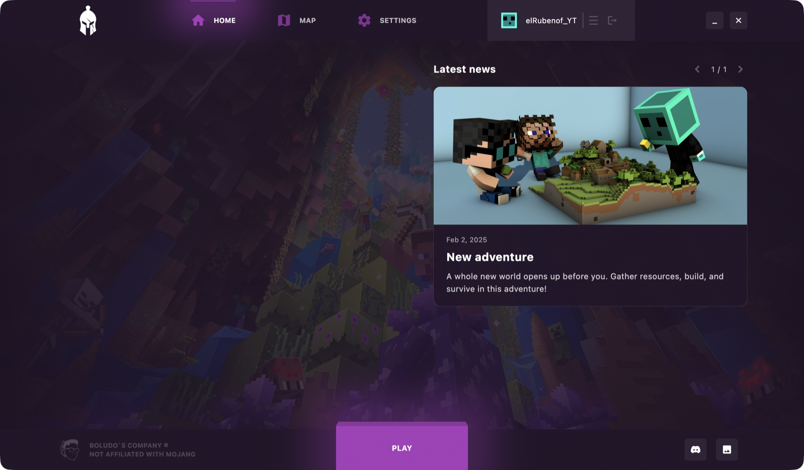
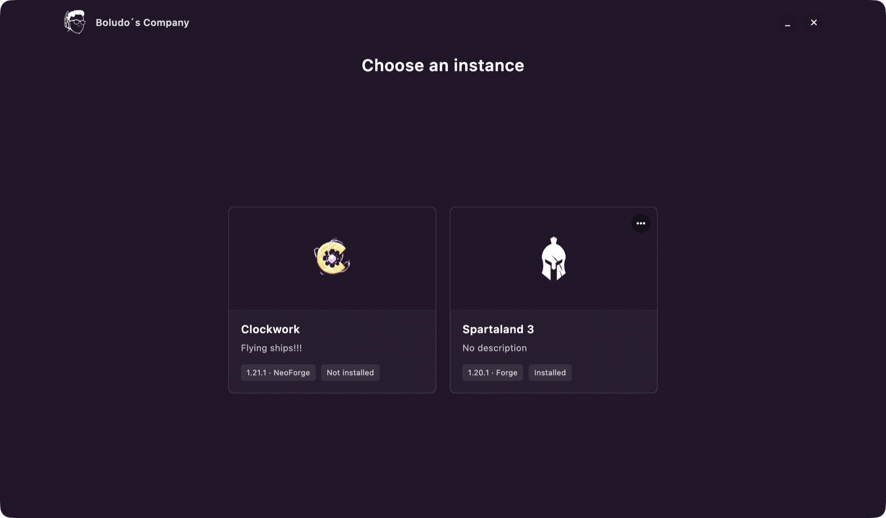

<p align="center">
  
</p>

<h1 align="center">BC Launcher</h1>

<p align="center">
  A Minecraft launcher for series and events.<br>
  Add an organization, pick an instance and play: mods, configs and Java are taken care of.
</p>

<p align="center">
  <a href="https://github.com/elRubenof/bc-launcher/releases/latest"></a>
  <a href="https://github.com/elRubenof/bc-launcher/actions/workflows/ci.yml"></a>
  <a href="LICENSE"></a>
</p>

<p align="center">
  English · <a href="README.es.md">Español</a>
</p>

<p align="center">
  
  
</p>

## What it does

- **Organizations by link.** An organization (the people behind a series or event) gives you a link; open it and the launcher adds it after asking you.
- **Instances always up to date.** Each instance downloads its mods, resource packs and configs from the organization, and repairs anything changed or missing before you play.
- **Every loader.** Vanilla, Fabric, Quilt, Forge (1.7.10+) and NeoForge (1.20.2+). The launcher installs Minecraft, the loader and the right Java version by itself.
- **News and links.** Each instance shows its news, web tabs and Discord or web links.
- **Offline play.** An installed instance still opens when the organization or your connection is down.

## Download

| System | File | Requirements |
|---|---|---|
| Windows | [BC-Launcher-Installer.exe](https://github.com/elRubenof/bc-launcher/releases/latest/download/BC-Launcher-Installer.exe) | Windows 10 or 11, 64-bit |
| macOS | [BC-Launcher.dmg](https://github.com/elRubenof/bc-launcher/releases/latest/download/BC-Launcher.dmg) | macOS 12 or later, Intel or Apple silicon |
| Linux | [BC-Launcher.AppImage](https://github.com/elRubenof/bc-launcher/releases/latest/download/BC-Launcher.AppImage) | x86_64 |

You don't need Java installed. Older versions and release notes are in [Releases](https://github.com/elRubenof/bc-launcher/releases).

## Installation

BC Launcher is free and open source, but it isn't signed with a paid certificate, so your system doesn't recognize it and warns you the first time. These steps get you past it.

### Windows

1. Open `BC-Launcher-Installer.exe`.
2. If **Windows protected your PC** appears, click **More info**.
3. Click **Run anyway** and follow the installer.

It installs for your user only, without administrator rights.

### macOS

1. Open `BC-Launcher.dmg` and drag **BC Launcher** to **Applications**.
2. Open it from Applications. If macOS says it can't verify it's free of malware, click **Done**.
3. Go to **System Settings › Privacy & Security**, scroll to the bottom and click **Open Anyway**. Confirm with your password.

### Linux

1. Right-click `BC-Launcher.AppImage` › **Properties** and check **Allow executing file as program**, or run `chmod +x BC-Launcher.AppImage`.
2. Double-click it. The first time it adds itself to your applications menu.

If it doesn't start, install your distribution's FUSE package (`fuse3` on most of them).

## Updates

The launcher checks for a new version when it starts and every few hours.

- **Windows:** it downloads the update by itself and asks you to restart. It never restarts while you're playing.
- **macOS and Linux:** it lets you know and **Download** opens the new version. Install it over the old one, as above; your instances, worlds and account stay.

## Adding an organization

Open your organization's page and click **Open in BC Launcher**. The launcher asks whether you want to add it and then signs you in to it. There is no field to type an address: organizations are only added from their link.

With two or more organizations, a column on the left lets you switch between them.

## For organizations

To run your own organization (instances, content, news, player access), deploy [BC Launcher Server](https://github.com/elRubenof/bc-launcher-server). Its public page gives your players the download links and the link that adds your organization.

## Building from source

Requires [Flutter](https://flutter.dev) 3.47 or later (stable).

1. Copy `.env.example` to `.env` and set `MS_CLIENT_ID` to your Azure app's client ID (`MS_REDIRECT_URL` is optional).
2. Run it:

```bash
flutter pub get
flutter run -d windows --dart-define-from-file=.env
```

Use `-d macos` or `-d linux` on those systems. `flutter test` runs the tests. [AGENTS.md](AGENTS.md) explains the project's structure, the installers and the release process.

## License

[GPL-3.0](LICENSE)
